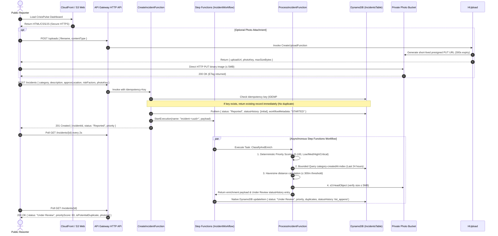

# CrisisPulse — System Architecture & Design Specification

> **Community Incident Reporting & Response Operations Platform**  
> An AWS Serverless, Least-Privilege, Deterministic MVP.

---

## 1. High-Level Component Topology

```mermaid
flowchart TD
    subgraph ClientLayer ["1. Client & Presentation Layer"]
        User["Public User (Web/Mobile)"]
        Coord["Emergency Coordinator"]
        CF["AWS CloudFront Distribution (HTTPS / TLS 1.2+)\nDomain: *.cloudfront.net"]
        S3Web["Private S3 Website Bucket\n(Origin Access Control - OAC)"]
    end

    subgraph IngressLayer ["2. Ingress & Routing Layer"]
        HttpApi["API Gateway HTTP API\n• Throttling: Rate 50/s, Burst 100\n• CORS Configured\n• JWT / Cognito Coordinator Authorizer"]
    end

    subgraph ComputeLayer ["3. Serverless Compute Layer (Python 3.12)"]
        HHealth["HealthFunction\n(GET /health)"]
        HUpload["CreateUploadFunction\n(POST /uploads)"]
        HCreate["CreateIncidentFunction\n(POST /incidents)"]
        HList["ListIncidentsFunction\n(GET /incidents)"]
        HGet["GetIncidentFunction\n(GET /incidents/{id})"]
        HUpdate["UpdateIncidentFunction\n(PATCH /incidents/{id})"]
        HCoord["CoordinatorUpdateStatusFunction\n(POST /coordinator/.../status)"]
        HProcess["ProcessIncidentFunction\n(Step Functions Task)"]
    end

    subgraph WorkflowLayer ["4. Orchestration Layer"]
        SFN["AWS Step Functions (Standard)\nState Machine: IncidentWorkflow"]
    end

    subgraph StorageLayer ["5. Data & Storage Layer"]
        DDB[("Amazon DynamoDB (On-Demand)\nPK: incidentId\nGSI-1: createdAt-index\nGSI-2: category-createdAt-index\nTTL Enabled")]
        S3Photos["Amazon S3 Private Photo Bucket\n• BlockPublicAccess (100%)\n• DenyInsecureTransport Policy\n• Presigned PUT/GET URLs"]
    end

    User -->|Browse HTTPS| CF
    Coord -->|Browse HTTPS| CF
    CF -->|Signed Read| S3Web

    User -->|Submit Reports & View Feed| HttpApi
    Coord -->|Authorized Status Transitions| HttpApi

    HttpApi -->|GET /health| HHealth
    HttpApi -->|POST /uploads| HUpload
    HttpApi -->|POST /incidents| HCreate
    HttpApi -->|GET /incidents| HList
    HttpApi -->|GET /incidents/{id}| HGet
    HttpApi -->|PATCH /incidents/{id}| HUpdate
    HttpApi -->|POST /coordinator/incidents/{id}/status| HCoord

    HUpload -->|Issue Presigned PUT| S3Photos
    User -.->|Direct Binary PUT (≤5MB)| S3Photos

    HCreate -->|PutItem & Idempotency Key| DDB
    HCreate -->|Async StartExecution| SFN

    HList -->|Query createdAt-index| DDB
    HGet -->|GetItem & Issue Presigned GET| DDB
    HGet -->|Issue Presigned GET| S3Photos
    HUpdate -->|UpdateItem (Descriptive fields)| DDB
    HCoord -->|Enforce Lifecycle & Append History| DDB

    SFN -->|1. Classify & Detect Duplicates| HProcess
    HProcess -->|Bounded Query category-createdAt-index| DDB
    HProcess -->|HeadObject Verification| S3Photos
    SFN -->|2. Native UpdateItem (Enrichment & History)| DDB
```

---

## 2. End-to-End Workflow Execution Sequence



---

## 3. Storage & Indexing Strategy

### 3.1 Primary Table: `IncidentsTable`
- **Billing Mode**: `PAY_PER_REQUEST` (On-Demand capacity; zero idle cost).
- **Partition Key (PK)**: `incidentId` (String, UUIDv4).
- **Time-to-Live (TTL)**: Enabled on attribute `ttl` (automatically evicts 24h idempotency keys).

### 3.2 Global Secondary Indexes (GSIs)
| Index Name | Partition Key | Sort Key | Projection | Purpose |
| :--- | :--- | :--- | :--- | :--- |
| `createdAt-index` | `entityType` (S: "INCIDENT") | `createdAt` (S: ISO-8601) | `ALL` | Powers paginated, chronologically sorted feeds (`GET /incidents?order=desc`) without scans. |
| `category-createdAt-index` | `category` (S: "fire", etc.) | `createdAt` (S: ISO-8601) | `ALL` | Powers **bounded duplicate queries** (`category = :cat AND createdAt >= :cutoff_24h`), strictly eliminating table scans. |

### 3.3 Status History Timeline Schema
Stored as a native DynamoDB list of maps on every incident:
```json
"statusHistory": [
  {
    "status": "Reported",
    "timestamp": "2026-11-15T10:00:00Z",
    "actor": "public_user",
    "notes": "Initial incident submission received via API Gateway."
  },
  {
    "status": "Under Review",
    "timestamp": "2026-11-15T10:00:03Z",
    "actor": "step-functions",
    "notes": "Automated evaluation completed: Critical Priority (80/100). No duplicates detected within 300m."
  },
  {
    "status": "In Progress",
    "timestamp": "2026-11-15T10:14:00Z",
    "actor": "coordinator_lead",
    "notes": "Engine Company 4 and Ladder 2 dispatched to scene."
  }
]
```

---

## 4. Security & Least-Privilege IAM Matrix

| Component | AWS Resource | Granted Actions | Scope / Resource Constraint |
| :--- | :--- | :--- | :--- |
| `HealthFunction` | CloudWatch Logs | `logs:CreateLogStream`, `PutLogEvents` | Single function log group |
| `CreateUploadFunction` | `PhotoBucket` | `s3:PutObject` | Restricted to `uploads/*` only |
| `CreateIncidentFunction` | `IncidentsTable`, `IncidentWorkflow` | `dynamodb:PutItem`, `GetItem`, `states:StartExecution` | Incidents table ARN and State Machine ARN |
| `ListIncidentsFunction` | `IncidentsTable` | `dynamodb:Query` | Restricted to `createdAt-index` GSI |
| `GetIncidentFunction` | `IncidentsTable`, `PhotoBucket` | `dynamodb:GetItem`, `s3:GetObject` | Table ARN and `uploads/*` |
| `UpdateIncidentFunction` | `IncidentsTable` | `dynamodb:GetItem`, `UpdateItem` | Table ARN; code forbids status changes (403) |
| `CoordinatorUpdateStatusFunction` | `IncidentsTable` | `dynamodb:GetItem`, `UpdateItem` | Table ARN; requires Cognito / JWT auth (401) |
| `ProcessIncidentFunction` | `IncidentsTable`, `PhotoBucket` | `dynamodb:Query`, `s3:HeadObject` | `category-createdAt-index` GSI and `uploads/*` |
| `IncidentWorkflow` (SFN) | `ProcessIncidentFunction`, `IncidentsTable` | `lambda:InvokeFunction`, `dynamodb:UpdateItem` | Process Lambda ARN and Incidents Table ARN |

---

## 5. Frontend Hosting: CloudFront HTTPS vs S3 Static Website Limitations

| Architectural Feature | CloudFront + S3 (OAC) [Current Architecture] | S3 Static Website Hosting [Alternative] |
| :--- | :--- | :--- |
| **Transport Security** | **HTTPS / TLS 1.2+** with AWS Managed Certificate | **Cleartext HTTP only** (No custom domain HTTPS) |
| **Bucket Visibility** | **100% Private** (`BlockPublicAccess: true`) | **Public Read Required** (Disables bucket security blocks) |
| **Authorization** | Signed requests via **Origin Access Control (OAC)** | Open to public internet without origin restrictions |
| **Performance** | 450+ global edge locations; Brotli/Gzip compression | Single regional S3 endpoint |
| **Modern Browser Support**| Geolocation API works natively (requires HTTPS) | Browsers **block Geolocation API** over insecure HTTP |

---

## 6. Cost Estimation & Free Tier Utilization

CrisisPulse is designed to operate **100% within the AWS Free Tier** for evaluation and demonstration:

| Service | Free Tier Allowance | CrisisPulse Usage (Demo / Low Load) | Monthly Cost |
| :--- | :--- | :--- | :--- |
| **AWS Lambda** | 1,000,000 requests & 3.2M sec compute / month | ~5,000 requests & ~1,200 sec compute | **$0.00** |
| **Amazon DynamoDB** | 25 GB storage & 25 WCU / 25 RCU | On-Demand (Free within 25 GB storage) | **$0.00** |
| **Amazon S3** | 5 GB standard storage & 20,000 GET / 2,000 PUT | ~200 MB images, ~1,000 operations | **$0.00** |
| **API Gateway** | 1,000,000 HTTP API calls / month | ~10,000 calls | **$0.00** |
| **AWS Step Functions**| 4,000 state transitions / month | ~500 incident triage executions (~1,500 transitions) | **$0.00** |
| **Amazon CloudFront** | 1 TB data transfer out & 10,000,000 requests | < 5 GB transfer, ~15,000 requests | **$0.00** |
| **Total Estimated Cost**| — | — | **$0.00 / month** |
